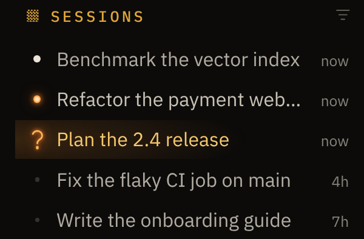

# Taelyos

A black-and-amber theme for [Hermes Desktop](https://github.com/NousResearch/hermes-agent).

The home screen is a tableau: a statue of Hermes holding a Nixie tube, between columns whose drums show the time.
The clock turns once a minute. Nothing else moves.

The session list shows where each conversation stands:

- **Lit neon point**: working, including subagents or a background job still running.
- **Neon question mark, row lit**: waiting for your answer.
- **Light point**: finished, not read yet.
- **Faint point**: at rest.

These marks are Desktop's own status dots, restyled in CSS, so they can't disagree with Hermes. The theme makes no
requests. Its only script is the clock, and it sleeps while the window is hidden.

## Install

In Hermes Desktop, open **Settings → Plugins**, click **Install from Git** and paste:

    https://github.com/Taelyos/hermes-taelyos

Then choose **Taelyos** in **Settings → Appearance → Theme**.

Or by hand: save [`desktop/plugin.js`](desktop/plugin.js) as `~/.hermes/desktop-plugins/taelyos/plugin.js`.
Desktop picks it up within a few seconds.

Made for Hermes 0.23.0 and tested on macOS and Linux. If a later version of Desktop renames its status-dot classes,
the rows fall back to Desktop's own dots.

## Credits

- Statue: *Hermes of the Belvedere*, Roman, Hadrianic period, after a Praxitelean bronze. 3D scan of cast KAS1161,
  Statens Museum for Kunst, Copenhagen, via Scan the World (MyMiniFactory), Public Domain Mark 1.0.
- Type: IBM Plex Sans, IBM Plex Sans Condensed and IBM Plex Mono, IBM's own files, unmodified.

## License

- Code: [MIT](LICENSE).
- Artwork (the images inside `desktop/plugin.js`, and the screenshots): [CC BY-NC 4.0](LICENSE-ART.md).
- IBM Plex: [SIL Open Font License 1.1](OFL.txt).

Made with [Hermes Agent](https://github.com/NousResearch/hermes-agent).
